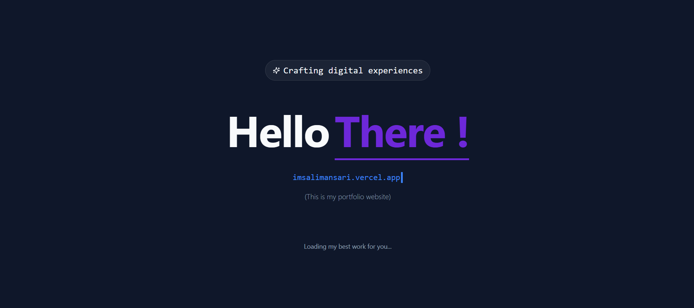
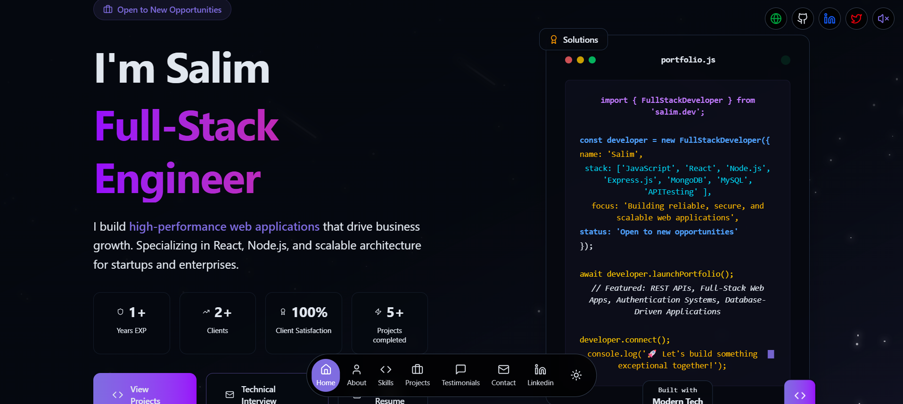
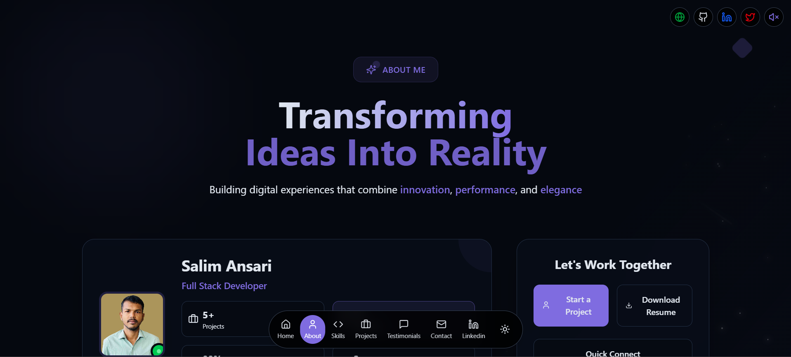
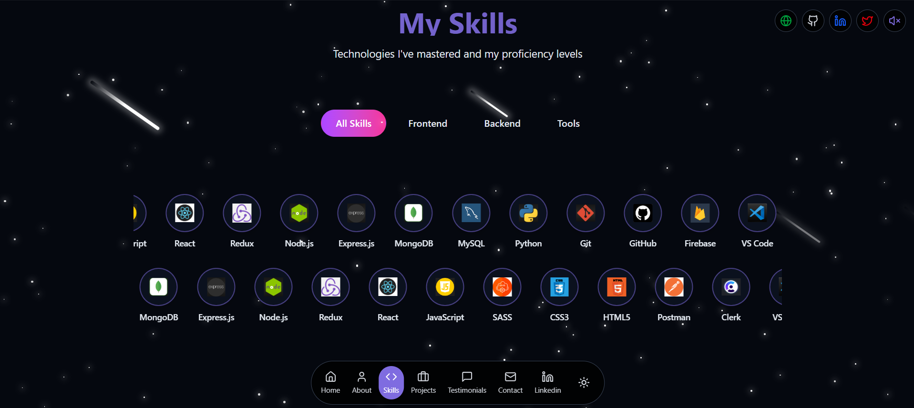
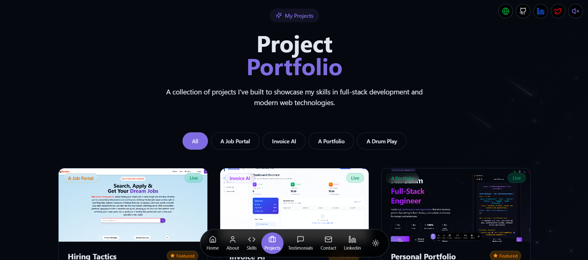
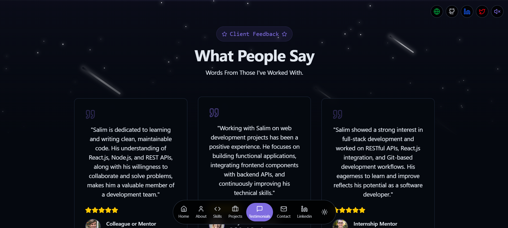
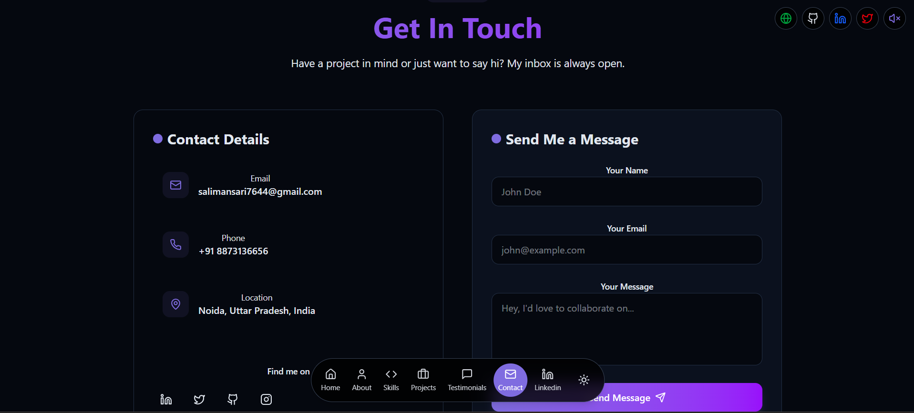

# 💼 Developer Portfolio | React, Vite & Tailwind CSS

A modern, responsive developer portfolio built with **React, Vite, JavaScript, and Tailwind CSS** to showcase my technical skills, projects, professional background, and contact information.

🌐 **Live Portfolio:** [imsalimansari.vercel.app](https://imsalimansari.vercel.app/)

## 🚀 Tech Stack

- **Frontend:** React.js
- **Build Tool:** Vite
- **Styling:** Tailwind CSS
- **Programming Language:** JavaScript (ES6+)
- **Animations:** Framer Motion (optional)
- **Deployment:** Vercel
- **AI Chatbot:** Under Development

## ✨ Features

- 📱 **Responsive Design** — Optimized for desktop, tablet, and mobile devices.
- 👨‍💻 **About Me** — Introduction, professional background, and development interests.
- 🛠️ **Skills Section** — Showcases technical skills and technologies.
- 🚀 **Projects Showcase** — Displays projects with descriptions, technology tags, and demo links.
- 💬 **Testimonials Section** — Dedicated section for client or collaborator feedback.
- 📩 **Contact Section** — Makes it easy to connect and discuss opportunities.
- 🎨 **Modern UI** — Clean layout with smooth navigation and interactive elements.
- ⚙️ **Easy Customization** — Project and skill information can be managed through data files.
- 🤖 **AI Chatbot** — Planned feature, currently under development.

## 📸 Screenshots

### 🏠 Home Page

| Loader Page | Home Page |
|---|---|
|  |  |

### 👨‍💻 Portfolio Sections

| About | Skills |
|---|---|
|  |  |

| Projects | Testimonials |
|---|---|
|  |  |

### 📩 Contact Section



## 🛠️ Getting Started

Follow these steps to run the project locally.

### Prerequisites

Make sure you have installed:

- [Node.js](https://nodejs.org/)
- npm (included with Node.js)
- Git

### 1. Clone the Repository

```bash
git clone https://github.com/imsalimansari/Portfolio.git
```

### 2. Navigate to the Client Directory

```bash
cd Portfolio/client
```

> **Note:** This assumes your React application is inside the `client` directory. If `package.json` is in the repository root, navigate to `Portfolio` instead.

### 3. Install Dependencies

```bash
npm install
```

### 4. Start the Development Server

```bash
npm run dev
```

Open the local URL displayed in your terminal to view the portfolio.

## ⚙️ Customization

You can personalize the portfolio by updating the following files and directories:

- **Projects:** `src/data/projects.js`
- **Skills:** `src/data/skills.js`
- **Components:** `src/components/`
- **Pages:** `src/pages/`

Update the project information, skills, content, and layout according to your requirements.

## 🏗️ Build for Production

To generate an optimized production build, run:

```bash
npm run build
```

To preview the production build locally:

```bash
npm run preview
```

The generated production files are available in the `dist/` directory.

## 📤 Deployment

The portfolio can be deployed using the following platforms:

- **[Vercel](https://vercel.com/)** — Recommended for Vite and React applications.
- **[Netlify](https://www.netlify.com/)** — Alternative hosting platform for frontend applications.
- **[GitHub Pages](https://pages.github.com/)** — Static hosting with additional configuration when required.

### Deploying to Vercel

1. Push your code to GitHub.
2. Import the repository into Vercel.
3. Set the project root directory to `client` if the frontend is inside that folder.
4. Set the build command to `npm run build`.
5. Set the output directory to `dist`.
6. Deploy the project.

## 📬 Contact

I'm open to software development opportunities, collaborations, and professional networking.

- **Portfolio:** [imsalimansari.vercel.app](https://imsalimansari.vercel.app/)
- **GitHub:** [github.com/imsalimansari](https://github.com/imsalimansari)
- **LinkedIn:** [linkedin.com/in/imsalimansari](https://www.linkedin.com/in/imsalimansari/)
- **Email:** [salimansari7644@gmail.com](mailto:salimansari7644@gmail.com)

---

**Made with ❤️ by Salim Ansari using React, Vite, and Tailwind CSS.**
